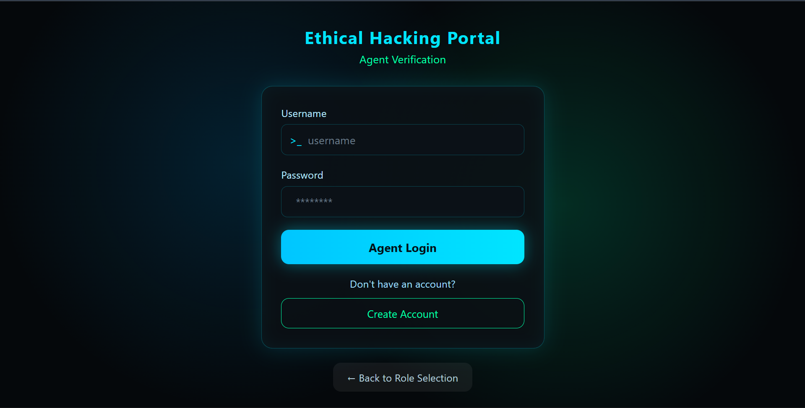
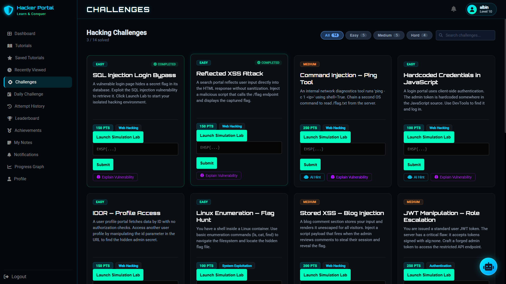
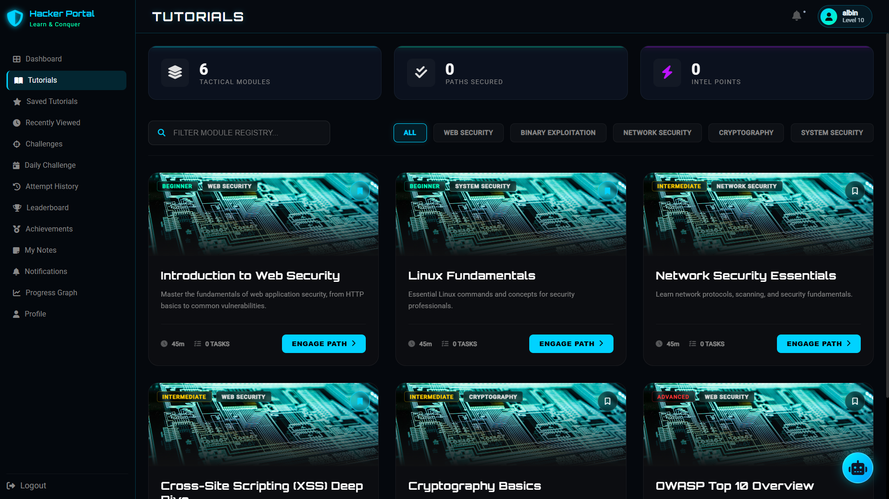
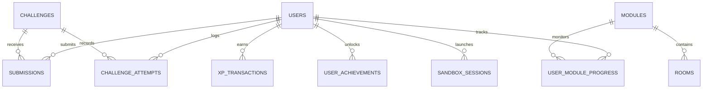
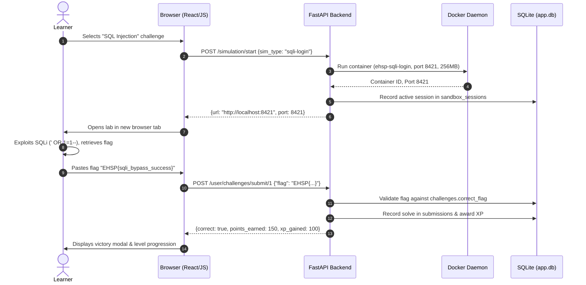

# 🛡️ Ethical Hacking Simulation Portal (EHSP)

[](https://www.python.org/)
[](https://fastapi.tiangolo.com/)
[](https://www.docker.com/)
[](#-license)

An interactive, gamified, browser-based cybersecurity training platform and simulation portal. EHSP allows learners to master offensive security concepts by reading structured learning paths, solving Capture-The-Flag (CTF) challenges, and launching **real, intentionally vulnerable web applications inside disposable Docker containers** with on-demand lifecycle controls. The platform integrates dual AI mentorship (Groq LLaMA 3.3 70B and Google Gemini 2.5 Flash), real-time WebSockets for notifications and social messaging, an XP/leveling progression system, and an administrative operations control center with an isolated Python execution sandbox.

> [!CAUTION]
> **EDUCATIONAL AND RESEARCH USE ONLY.**
> The simulation containers and code challenges included in this repository contain intentionally critical vulnerabilities (SQL Injection, Remote Code Execution, SSRF, IDOR, Privilege Escalation, etc.). These environments must only be deployed on private, isolated local networks or dedicated security lab hosts. Never expose vulnerable simulation containers or API endpoints to the public Internet.

---

## 📸 Screenshots

| Authentication & Entry | Learner Operations Dashboard |
| :---: | :---: |
|  |  |
| *Cyberpunk-themed dual authentication (Learner & Admin)* | *Metrics, active labs, streak tracker, and recent activity* |

| CTF Challenges & Lab Manager | Guided Learning Modules & Tutorials |
| :---: | :---: |
|  |  |
| *Category filtering, difficulty tags, and one-click Docker launch* | *Structured learning paths with reader view and bookmarking* |

---

## 📑 Table of Contents

1. [Project Overview & Architecture](#-project-overview--architecture)
2. [Feature Matrix](#-feature-matrix)
3. [Technology Stack](#-technology-stack)
4. [Simulation Labs Reference](#-simulation-labs-reference)
5. [Prerequisites & System Requirements](#-prerequisites--system-requirements)
6. [Installation & Setup](#-installation--setup)
7. [Environment Variables & Configuration](#-environment-variables--configuration)
8. [Service Management (Start, Stop, Restart)](#-service-management-start-stop-restart)
9. [Database Architecture & Migrations](#-database-architecture--migrations)
10. [Repository Structure](#-repository-structure)
11. [User Roles & Key Workflows](#-user-roles--key-workflows)
12. [API Documentation & Reference](#-api-documentation--reference)
13. [XP, Leveling & Gamification](#-xp-leveling--gamification)
14. [Testing & Verification](#-testing--verification)
15. [Troubleshooting Guide](#-troubleshooting-guide)
16. [Security Considerations & Known Limitations](#-security-considerations--known-limitations)
17. [Contribution Guidelines & Roadmap](#-contribution-guidelines--roadmap)
18. [License & Acknowledgements](#-license--acknowledgements)

---

## 🏛️ Project Overview & Architecture

### Problem Statement
Aspiring cybersecurity practitioners and software engineers often struggle with the gap between static theory and real-world penetration testing. Traditional CTF platforms either rely on static string analysis without live systems or require heavyweight, resource-intensive virtual machine orchestration that is difficult to set up and maintain on modern workstations.

### Solution
EHSP addresses this challenge by providing a lightweight, unified, zero-build web platform combining:
- A high-performance **FastAPI** backend that orchestrates containerized attack surfaces via the **Docker Python SDK**.
- **Ephemeral container lifecycles**: vulnerable environments spin up on unique host ports (`8100–8999`) with memory and CPU constraints, automatically terminating after 15 minutes to preserve host resources.
- A **dual AI layer** that acts as an automated cybersecurity tutor, offering contextual nudges without spoiling answers, and generating comprehensive post-exploit root cause analyses.

### High-Level System Architecture

```
                    ┌────────────────────────────────────────────────────────┐
                    │                   Client Browser                       │
                    │   React 18 (UMD/Babel) + Vanilla ES6 + Chart.js        │
                    │   HTML5 / CSS3 Cyberpunk Dark Theme / WebSockets       │
                    └────────────────────────────────────────────────────────┘
                                     │                        ▲
                    HTTP REST API    │                        │  WebSocket Push
                    Port 8000        ▼                        │  (/ws/*)
                    ┌────────────────────────────────────────────────────────┐
                    │                   FastAPI Backend                      │
                    │   backend/main.py  (Port 8000)                         │
                    │   ├─ Routes: Auth, Challenges, Modules, Social, Admin  │
                    │   ├─ Static File Server: Mounts /frontend              │
                    │   └─ Database Layer: SQLite3 (backend/app.db)          │
                    └───────────┬────────────────────────────┬───────────────┘
                                │                            │
                Docker Socket   │                            │ HTTPS
                (docker.sock)   │                            │ API Calls
                                ▼                            ▼
            ┌───────────────────────────┐        ┌───────────────────────────┐
            │   Docker Engine (Daemon)  │        │   External AI Providers   │
            │                           │        │                           │
            │  ┌─────────────────────┐  │        │  • Groq API               │
            │  │ Ephemeral Lab Apps  │  │        │    (llama-3.3-70b)        │
            │  │ (ehsp-sqli-login...)│  │        │    Hints, Explanations,   │
            │  │ Ports: 8100–8999    │  │        │    Skill Reports          │
            │  │ 256MB RAM / 15m TTL │  │        │                           │
            │  └─────────────────────┘  │        │  • Google Gemini API      │
            │  ┌─────────────────────┐  │        │    (gemini-2.5-flash)     │
            │  │ Admin Python Box    │  │        │    Interactive Mentor     │
            │  │ (python:3.10-alpine)│  │        │    Chatbot                │
            │  │ No Net / Read-Only  │  │        └───────────────────────────┘
            │  └─────────────────────┘  │
            └───────────────────────────┘
```

---

## ⚡ Feature Matrix

| Domain | Feature | Status | Implementation Details |
|---|---|:---:|---|
| **Simulation Labs** | 13 Ephemeral Docker Labs | **Implemented** | Automated launch, port allocation (8100–8999), 15-minute background auto-kill thread (`simulation_manager.py`). |
| | Manual Container Termination | **Implemented** | API endpoint `POST /simulation/stop` terminates and force-removes containers on demand. |
| | Stale Container Cleanup | **Implemented** | Name collision handling removes orphaned containers before spawning a new instance. |
| **CTF Challenges** | Static & Container Challenges | **Implemented** | 14 seeded challenges across Web Hacking, Linux, Cryptography, and Enumeration. |
| | Flag Validation Engine | **Implemented** | Verifies flags against database; case-insensitive, prevents duplicate point awards. |
| | Attempt Logging & Analytics | **Implemented** | Every attempt is logged in `challenge_attempts` for solve rates and audit tracking. |
| | Dynamic Per-User Flags | *Planned* | Flags are currently static strings defined per challenge in `challenges.correct_flag`. |
| **Curriculum** | Structured Learning Modules | **Implemented** | 6 courses split into sub-unit rooms with completion states and progress percentages. |
| | Tutorials & Knowledge Library | **Implemented** | Standalone guides with full-text search, reading pane, and bookmarking. |
| **Gamification** | 15-Tier Leveling System | **Implemented** | XP progression from *Script Kiddie* (0 XP) to *LEGENDARY* (10,000 XP) via `xp_service.py`. |
| | Daily Challenges & Rotations | **Implemented** | Automatic selection excluding past 7 days, speed completion bonuses, top solver board. |
| | Daily Logins & Streaks | **Implemented** | Daily login reward (25 XP), 7-day milestone bonuses (50 XP), streak shield tracking. |
| | Global Leaderboards | **Implemented** | Points synchronized across challenges and daily bonuses (`sync_user_points`). |
| | Achievement Badges | **Implemented** | 9 unlockable badges tracking solve counts, milestones, and system engagement. |
| **AI Mentorship** | Contextual Hint Generator | **Implemented** | Groq LLaMA 3.3 70B produces beginner-friendly nudges without revealing solutions. |
| | Vulnerability Explainer | **Implemented** | Structured root-cause, attack mechanism, impact, and prevention breakdown. |
| | Skill Gap Assessment | **Implemented** | Evaluates learner solve history to recommend targeted training paths. |
| | Mentor Chatbot | **Implemented** | Google Gemini 2.5 Flash chatbot with contextual awareness of user level and active page. |
| | Daily AI Rate Limiting | *Partial* | Defined in `routes/ai.py` (`DAILY_LIMIT = 20`), currently bypassed in code during development. |
| **Admin Center** | Metrics & Solve Analytics | **Implemented** | Aggregate platform metrics, solve distribution, registration timeline via Chart.js. |
| | Content Management (CRUD) | **Implemented** | Complete web management for challenges, modules, rooms, tutorials, and announcements. |
| | User Administration | **Implemented** | Inspect user profiles, activate/deactivate accounts, toggle user roles. |
| | Isolated Python Sandbox | **Implemented** | Executes Python code inside `python:3.10-alpine` (no network, 128MB RAM, 6s timeout). |
| **Social & Live** | Real-Time Notifications | **Implemented** | WebSocket push notifications for announcements, milestone unlocks, and system alerts. |
| | Social Direct & Group Chat | **Implemented** | WebSockets connection manager (`ws_social.py`) with message broadcasting. |
| | Friend Requests & Discovery | **Implemented** | User discovery, request sending, accept/reject workflows. |
| **Security & Auth**| Cryptographic Password Hashing | *Planned* | Passwords currently stored and verified in plain text. |
| | Signed JWT / Session Tokens | *Planned* | Auth uses client-side localStorage and HTTP request headers (`user-id`, `role`). |

---

## 🧰 Technology Stack

### Backend Core
- **Language**: Python 3.10+ (Verified on Python 3.14.7)
- **Web Framework**: [FastAPI](https://fastapi.tiangolo.com/) `0.162.0`
- **ASGI Server**: [Uvicorn](https://www.uvicorn.org/) `0.54.0` (with `watchfiles` file-watcher)
- **Data Validation**: [Pydantic](https://docs.pydantic.dev/) `2.14.1` (v2 core)
- **Container SDK**: [Docker SDK for Python](https://docker-py.readthedocs.io/) `7.2.0`
- **HTTP Client**: [HTTPX](https://www.python-httpx.org/) `0.28.1` & [Requests](https://requests.readthedocs.io/) `2.34.2`
- **Environment Management**: `python-dotenv` `1.2.4`
- **WebSockets**: `websockets` `17.3` & Starlette WebSocket protocol

### Artificial Intelligence Integration
- **Offensive Security AI**: [Groq Python SDK](https://github.com/groq/groq-python) `1.7.0` running `llama-3.3-70b-versatile`
- **Interactive Mentor AI**: [Google GenAI SDK](https://github.com/google-gemini/generative-ai-python) `2.33.0` running `gemini-2.5-flash`

### Database Engine
- **Storage**: SQLite 3 (Database file: `backend/app.db`)
- **Driver**: Python Standard Library `sqlite3` with row dictionary mapping (`sqlite3.Row`)
- **Migrations**: Custom schema migration scripts (`backend/migrations/`)

### Frontend Architecture
- **Framework**: React 18 (Loaded via UMD CDN, client-side JSX transpilation via in-browser Babel)
- **State & Logic**: Modular Vanilla JavaScript ES6 (`frontend/user/`, `frontend/admin/`, `frontend/js/`)
- **Data Visualizations**: [Chart.js](https://www.chartjs.org/) (Analytics, XP graphs, activity heatmaps)
- **Markdown Parser**: [Marked.js](https://marked.js.org/) (Tutorials, challenge writeups)
- **Typography & Icons**: Google Fonts (*Orbitron*, *Roboto*) and Font Awesome 6
- **Styling**: Pure CSS3 (Cyberpunk / dark terminal design system, custom responsive layout)

---

## 🧪 Simulation Labs Reference

The platform includes 13 independent vulnerable applications located in `simulations/`. Each lab contains an `app.py` (Flask web application), `Dockerfile` (`python:3.10-slim`), and `requirements.txt`. All containers listen internally on port `5000` and are exposed on randomly allocated host ports (`8100–8999`).

| # | Difficulty | Simulation Name (`sim_type`) | Target Image | Vulnerability Category | Description & Objective |
|---|:---:|---|---|---|---|
| 1 | 🟢 Easy | `sqli-login` | `ehsp-sqli-login` | SQL Injection | Authentication bypass via unescaped SQL query strings in login forms. |
| 2 | 🟢 Easy | `xss-reflected` | `ehsp-xss-reflected` | Reflected XSS | Input reflection in search parameters enabling script injection. |
| 3 | 🟢 Easy | `cmd-injection` | `ehsp-cmd-injection` | Command Injection | Unsanitized network ping utility executing chained system commands. |
| 4 | 🟢 Easy | `hardcoded-creds`| `ehsp-hardcoded-creds`| Information Disclosure | Hardcoded administrative authentication tokens within client-side JavaScript. |
| 5 | 🟢 Easy | `idor-profile` | `ehsp-idor-profile` | IDOR | Direct parameter tampering in user profile endpoints to access unauthorized data. |
| 6 | 🟢 Easy | `linux-flag-hunt`| `ehsp-linux-flag-hunt`| System Enumeration | Interactive web terminal requiring Linux directory inspection and permissions analysis. |
| 7 | 🟡 Medium | `stored-xss` | `ehsp-stored-xss` | Stored XSS | Persistent script injection via guestbook/comments stealing simulated admin cookies. |
| 8 | 🟡 Medium | `jwt-manipulation`| `ehsp-jwt-manipulation`| Cryptographic Flaw | Unverified JWT signatures (`alg: none`) allowing role escalation to administrator. |
| 9 | 🟡 Medium | `broken-access-control`| `ehsp-broken-access-control`| Access Control | Client-controlled HTTP authorization headers granting access to administrative endpoints. |
| 10 | 🔴 Hard | `blind-sqli` | `ehsp-blind-sqli` | Blind SQL Injection | Boolean-based data extraction through programmatic substring interrogation. |
| 11 | 🔴 Hard | `ssrf` | `ehsp-ssrf` | SSRF | Server-Side Request Forgery forcing backend requests to private loopback services. |
| 12 | 🔴 Hard | `priv-esc` | `ehsp-priv-esc` | Privilege Escalation | Exploiting vulnerable SUID binaries inside a restricted Linux shell to escalate to root. |
| 13 | 🔴 Hard | `rce-eval` | `ehsp-rce-eval` | Code Execution | Arbitrary Python code execution through unescaped `eval()` mathematical inputs. |

> Detailed exploitation guides and flag references are documented in [README_CHALLENGES.md](README_CHALLENGES.md).

---

## 💻 Prerequisites & System Requirements

### Hardware Recommendations
- **CPU**: Modern x86_64 or ARM64 processor (minimum 2 cores, 4 cores recommended for running multiple containers simultaneously).
- **RAM**: Minimum 4 GB physical RAM (8 GB+ recommended when hosting several active simulation containers).
- **Disk Space**: At least 5 GB available free storage for Docker base images, simulation builds, and SQLite database storage.

### Software Prerequisites
1. **Operating System**: Windows 10/11 (64-bit), macOS 12+, or modern Linux distribution (Ubuntu 20.04+, Debian 11+, Fedora 38+).
2. **Python**: Python 3.10, 3.11, 3.12, 3.13, or 3.14 (Verified running on Python `3.14.7`).
3. **Docker Engine**: Docker Desktop or native Docker Engine daemon actively running.
4. **Internet Connectivity**: Required on first load to fetch CDN dependencies (React, Babel, Chart.js) and to communicate with cloud AI APIs (Groq and Google Gemini).

---

## 📦 Installation & Setup

### 1. Clone the Repository
```bash
git clone <repository_url> ethical-hacking-portal
cd ethical-hacking-portal
```

### 2. Configure Python Virtual Environment
It is strongly recommended to install project dependencies into an isolated virtual environment.

**Windows (PowerShell):**
```powershell
python -m venv venv
.\venv\Scripts\activate
```

**macOS / Linux:**
```bash
python3 -m venv venv
source venv/bin/activate
```

### 3. Install Backend Dependencies
Install the required packages using `pip`:

```bash
pip install fastapi "uvicorn[standard]" pydantic python-dotenv python-multipart docker groq google-genai pyjwt requests websockets watchfiles
```

### 4. Build the Simulation Lab Docker Images
Before learners can launch simulation labs, the Docker images must be built locally. Ensure Docker Desktop or the Docker daemon is running:

**Windows (Automated Batch Script):**
```cmd
.\build_all.bat
```

**Linux / macOS (Bash Loop):**
```bash
for lab in sqli-login xss-reflected blind-sqli cmd-injection rce-eval stored-xss ssrf \
           jwt-manipulation idor-profile broken-access-control hardcoded-creds \
           linux-flag-hunt priv-esc; do
    echo "[*] Building ehsp-$lab..."
    docker build -t "ehsp-$lab" "simulations/$lab"
done
```

**Pull Sandbox Base Image:**
The admin Python execution sandbox requires the official Alpine Python image:
```bash
docker pull python:3.10-alpine
```

**Verify Docker Images:**
```bash
docker images | grep ehsp
# Windows Command Prompt:
docker images | findstr ehsp
```
*Verification*: You should see 13 images tagged `ehsp-*`.

---

## ⚙️ Environment Variables & Configuration

The application reads configuration from environment variables or a local `.env` file located in `backend/.env`.

### Creating `backend/.env`
Create a `.env` file inside the `backend` directory (do not commit this file to version control):

```env
# =====================================================================
# ETHICAL HACKING SIMULATION PORTAL - ENVIRONMENT CONFIGURATION
# =====================================================================

# Groq API Key (Required for Hints, Vulnerability Explanations, Skill Reports)
# Obtain from: https://console.groq.com/keys
GROQ_API_KEY=your_groq_api_key_here

# Google Gemini API Key (Required for AI Mentor Chatbot)
# Obtain from: https://aistudio.google.com/app/apikey
GEMINI_API_KEY=your_gemini_api_key_here
```

### Safe `.env.example`
A safe reference template can be maintained at `.env.example`:
```env
GROQ_API_KEY=
GEMINI_API_KEY=
```

### Key Configuration Settings in Codebase

| Variable / Constant | File Location | Default Setting | Operational Impact |
|---|---|---|---|
| `DB_PATH` | `backend/database.py` | `backend/app.db` | Absolute path to SQLite database. |
| `_TTL_SECONDS` | `backend/simulation_manager.py` | `900` (15 minutes) | Automatic background container termination timeout. |
| `port` range | `backend/simulation_manager.py` | `8100` to `8999` | Random host port range assigned to launched Docker labs. |
| Lab Resource Limits | `backend/simulation_manager.py` | `256m` RAM, `50%` CPU | Hard container limits preventing host system exhaustion. |
| Sandbox Limits | `backend/services/sandbox_service.py`| `128m` RAM, `6s` timeout | Strict isolation: no network, read-only FS, max 50 PIDs. |
| `DAILY_LIMIT` | `backend/routes/ai.py` | `20` calls/day | AI quota limiter (currently bypassed during development). |

---

## 🚦 Service Management (Start, Stop, Restart)

### 1. Launching the Backend Server

> [!IMPORTANT]
> Always execute startup commands from the **repository root directory** (`ethical-hacking-portal/`), because relative SQLite database paths resolve to `backend/app.db`.

**Using Windows Batch Script:**
```cmd
.\start_backend.bat
```

**Manual Command (All Operating Systems):**
```bash
python -m uvicorn backend.main:app --reload --reload-dir backend --host 127.0.0.1 --port 8000
```

*Why `--reload-dir backend`?*
Limiting Uvicorn's file watcher strictly to the `backend/` directory prevents database journaling writes or frontend asset modifications from causing unwanted server restarts.

### 2. Stopping the Backend Server
In the active terminal window running Uvicorn:
- Press `Ctrl + C` (or `Cmd + C` on macOS) to gracefully shut down the ASGI worker process.

### 3. Restarting the Server
Simply repeat the start command after stopping. SQLite database state and built Docker images persist between restarts.

### 4. Managing Active Simulation Containers
If containers remain active after development sessions, inspect and clean them using Docker CLI:

```bash
# List all EHSP simulation containers
docker ps -a --filter "label=ehsp=simulation"

# Remove all lingering EHSP simulation containers
docker rm -f $(docker ps -aq --filter "label=ehsp=simulation")
```

### 5. Alternative: Static Lab Testing with Docker Compose
If you wish to test all 13 simulation labs simultaneously on fixed ports (`5001–5013`) without using the dynamic portal manager:

```bash
# Start all 13 labs in detached mode
docker compose up -d

# Stop all compose labs
docker compose down
```

---

## 🗄️ Database Architecture & Migrations

EHSP utilizes **SQLite 3** (`backend/app.db`). The schema consists of **34 tables** spanning user authentication, gamification, curriculum, CTF submissions, real-time messaging, and container audit logs.

### Schema Table Overview



| Domain | Table Name | Verified Columns | Purpose |
|---|---|---|---|
| **Users & Identity** | `users` | `id, username, email, password, role, status, level, points, avatar, bio, github_url, portfolio_url, htb_profile, thm_profile, skills, theme_color, created_at, xp, streak, last_active, country, hacker_title, twitter_url, linkedin_url` | Core account data, profile handles, rank, and aggregated scores. |
| **Gamification** | `xp_transactions` | `id, user_id, amount, reason, source_id, created_at` | Audit ledger for XP awards and level recalculations. |
| | `streak_shields` | `id, user_id, shields` | Streak preservation tokens for daily activity gaps. |
| | `achievements` | `id, title, description, points, icon, type, target` | Master definition of unlockable achievement badges. |
| | `user_achievements`| `id, user_id, achievement_id, progress, unlocked_at` | Per-user progress toward badges. |
| **Challenges & CTF**| `challenges` | `id, title, description, difficulty, points, correct_flag, category, docker_image, is_active, is_sim_lab, sim_type, instructions, hints` | Master challenge catalog (static and Docker targets). |
| | `user_challenges` | `id, user_id, challenge_id, status, attempts, score, started_at, solved_at` | Individual user progress and attempt counts per challenge. |
| | `challenge_attempts`| `id, user_id, challenge_id, submitted_flag, is_correct, attempted_at` | Complete submission history including failed payloads. |
| | `submissions` | `id, user_id, challenge_id, submitted_flag, is_correct, submitted_at, created_at, display_title` | Deduplicated correct solves used for official score calculation. |
| **Daily Engine** | `daily_challenges` | `id, challenge_id, challenge_date, bonus_points, created_at` | Daily challenge rotation history. |
| | `daily_attempts` | `id, daily_id, user_id, start_time, end_time, completion_time, is_completed, bonus_earned` | Speed-run timing logs for daily challenge bonuses. |
| | `daily_challenge_completions`| `user_id, daily_challenge_id, completed_at, bonus_earned` | Daily solve deduplication. |
| **Learning System** | `modules` | `id, title, description, difficulty, category, thumbnail_url, is_published, created_at, views` | High-level learning paths. |
| | `rooms` | `id, module_id, title, description, content, order_index, points, content_type` | Sub-unit rooms containing educational material. |
| | `user_module_progress`| `id, user_id, module_id, progress_percent, completed, last_accessed` | Course completion tracking. |
| | `user_room_progress`| `id, user_id, room_id, completed, completed_at` | Granular per-room completion markers. |
| | `tutorials` | `id, title, content, category, created_at, difficulty, duration, views` | Standalone technical tutorials. |
| | `saved_modules`, `saved_tutorials`, `recently_viewed` | Junction structures storing saved items and viewing history. |
| **Social & Messaging**| `friendships` | `id, requester_id, addressee_id, status, created_at` | User connection states (`pending`, `accepted`). |
| | `direct_messages` | `id, sender_id, receiver_id, content, is_read, sent_at` | Direct user-to-user chat history. |
| | `chat_groups`, `group_members`, `group_messages` | Relational group chat messaging infrastructure. |
| **Container & Audit**| `sandbox_sessions`| `id, user_id, challenge_id, container_id, port, started_at, expires_at, status, container_name, stopped_at, last_activity` | Audit log of all launched Docker simulation containers. |
| | `sandbox_exec_logs`| `id, user_id, container_id, execution_time, memory_used, exit_code, output, code_snippet, flag, created_at` | Execution outputs and flags from admin Python sandbox runs. |
| | `ai_logs` | `id, user_id, feature, created_at` | Historical log of AI prompt calls. |
| | `notes` | `id, user_id, title, content, created_at` | Learner private notes scratchpad. |
| | `notifications`, `user_notifications` | Broadcast notifications and user read states. |

### Database Initialization & Maintenance Scripts
Execute these scripts from the repository root as needed:

```bash
# 1. Initialize learning modules and rooms schema
python backend/init_modules_db.py

# 2. Seed default learning courses and tutorial rooms
python backend/seed_modules.py

# 3. Seed challenge database with Docker simulation lab records
python seed_simulation_labs.py

# 4. Migrate extended profile fields (social links, bio, handles)
python backend/migrations/add_profile_fields.py

# 5. Synchronize user leaderboard points with valid submissions
python scripts/sync_all_users_points.py
```

---

## 📂 Repository Structure

```
ethical-hacking-portal/
├── backend/                                # FastAPI Backend Server
│   ├── main.py                             # Application entry point, router registration & static mounting
│   ├── database.py                         # SQLite connection manager & points sync helper
│   ├── dependencies.py                     # Role-based dependency guards (admin_required)
│   ├── simulation_manager.py               # Docker SDK container lifecycle & port allocation
│   ├── app.db                              # Active SQLite database file
│   ├── .env                                # Local API keys (Groq & Gemini - not committed)
│   ├── init_modules_db.py                  # Module and room schema generator
│   ├── seed_modules.py                     # Initial learning course content seed
│   ├── migrations/                         # SQL and Python database migrations
│   │   ├── add_xp_system.py                # Automatic startup XP migration
│   │   ├── add_profile_fields.py           # User social fields migration
│   │   ├── create_social_tables.py         # Friends and chat schema
│   │   └── admin_sandbox.sql               # Sandbox log table definitions
│   ├── routes/                             # 31 modular API route handlers
│   │   ├── auth.py                         # Registration and authentication
│   │   ├── user_challenges.py              # Challenge listings, flag submission, stats
│   │   ├── simulation.py                   # Simulation start/stop/status endpoints
│   │   ├── ai.py                           # AI hints, explanations, skill gap reports
│   │   ├── chat.py                         # Interactive Gemini AI mentor chatbot
│   │   ├── daily_challenge.py              # Daily rotating challenge management
│   │   ├── xp.py                           # XP awards, levels, leaderboard
│   │   ├── modules.py & admin_modules.py   # Learning paths & course admin
│   │   ├── sandbox.py                      # Admin Python code runner
│   │   ├── social.py & ws_social.py        # Social networking & live chat WebSockets
│   │   ├── ws_notifications.py             # Push notification WebSocket manager
│   │   ├── user_profile.py                 # Profile editing and extended stats
│   │   └── admin.py & admin_users.py       # Administration metrics and user management
│   └── services/                           # Core business logic services
│       ├── ai_service.py                   # Groq API prompt builders (hints & explanations)
│       ├── skill_service.py                # Groq API skill gap evaluation
│       ├── xp_service.py                   # XP logic, ranks, streak bonuses
│       └── sandbox_service.py              # Isolated Docker execution runner
│
├── frontend/                               # Client-Side Application (Zero-Build Web App)
│   ├── index.html                          # Public landing page
│   ├── login.html, user-login.html         # User authentication interfaces
│   ├── admin-login.html                    # Administrator portal login
│   ├── user/                               # Learner Application Space
│   │   ├── dashboard.html                  # Main user layout shell
│   │   ├── user.js                         # Core client logic (3,300+ lines)
│   │   ├── tutorial-reader.html            # Standalone tutorial reader interface
│   │   └── components/                     # 18 Modular React (.jsx) components
│   │       ├── dashboard-view.jsx          # Learner dashboard stats & active lab widgets
│   │       ├── challenges-view.jsx         # Challenge cards, filters, Docker lab modals
│   │       ├── tutorials-view.jsx          # Module courses and room completion views
│   │       ├── profile-view.jsx            # User profile, heatmaps, badges, social links
│   │       ├── social-view.jsx             # Friends list, direct messages, group chat
│   │       ├── daily-view.jsx              # Daily challenge timer & solver rankings
│   │       └── notes-view.jsx              # Private user notes editor
│   ├── admin/                              # Administrator Control Center
│   │   ├── admin.html                      # Admin layout shell
│   │   ├── admin.js                        # Admin client controllers
│   │   └── components/                     # 11 Admin React (.jsx) components
│   │       ├── dashboard-view.jsx          # Platform-wide statistics & charts
│   │       ├── challenges-view.jsx         # Challenge CRUD and preview manager
│   │       ├── modules-view.jsx            # Learning module and room editor
│   │       ├── users-view.jsx              # Account auditing and status management
│   │       └── sandbox-view.jsx            # Live Python sandbox runner and execution log
│   ├── components/chat/                    # Embedded AI Mentor chat drawer
│   │   ├── chat.js & chat.css              # Chatbot widget logic & styling
│   └── js/                                 # Shared client utilities
│       ├── api.js & auth.js                # Fetch wrapper and session state
│       ├── theme-system.js                 # Cyberpunk theme customizer
│       ├── xp-system.js                    # XP level-up notifications & animations
│       └── ws-notifications.js             # Client WebSocket push listener
│
├── simulations/                            # 13 Intentionally Vulnerable Flask Apps
│   ├── sqli-login/                         # SQL injection login bypass
│   ├── xss-reflected/                      # Reflected cross-site scripting
│   ├── cmd-injection/                      # OS command injection utility
│   ├── hardcoded-creds/                    # Secrets exposed in frontend bundle
│   ├── idor-profile/                       # Insecure direct object reference
│   ├── linux-flag-hunt/                    # Web terminal Linux enumeration
│   ├── stored-xss/                         # Stored persistent XSS guestbook
│   ├── jwt-manipulation/                   # Token signature tampering
│   ├── broken-access-control/              # Authorization header bypass
│   ├── blind-sqli/                         # Boolean blind SQL injection
│   ├── ssrf/                               # Server-side request forgery
│   ├── priv-esc/                           # Linux SUID privilege escalation
│   └── rce-eval/                           # Python eval() code execution
│
├── SCREENSHOTS/                            # Verified UI screenshots for documentation
├── scripts/                                # Utility maintenance scripts
│   └── sync_all_users_points.py            # Global points recalculation
├── build_all.bat                           # Windows batch build script for all 13 labs
├── start_backend.bat                       # Windows batch startup for FastAPI
├── docker-compose.yml                      # Compose manifest for running all labs on ports 5001–5013
├── seed_simulation_labs.py                 # Challenge database seeder
├── README_CHALLENGES.md                    # Deep-dive exploitation reference & walkthroughs
└── README.md                               # Primary project documentation (this document)
```

---

## 👤 User Roles & Key Workflows

### Authentication Model
The system supports two user roles:
1. `user` (Learner): Standard access to challenges, simulation labs, modules, AI mentors, and personal profiles.
2. `admin` (Administrator): Elevated permissions for user moderation, challenge authoring, curriculum management, and Python sandbox execution.

> **Promoting a User to Admin:**
> New signups automatically receive the `user` role. To promote an account to administrator, update the database directly:
> ```bash
> sqlite3 backend/app.db "UPDATE users SET role='admin' WHERE username='your_username';"
> ```

---

### Core Learner Workflow



---

### Core Administrator Workflow
1. Navigate to `http://localhost:8000/frontend/admin-login.html` and sign in with an administrator account.
2. **Dashboard Overview**: Inspect total users, solve counts, and active Docker containers.
3. **Challenge Authoring**: Create new challenges, specify categories, assign points, and link them to Docker image tags (`ehsp-<name>`).
4. **Learning Module Management**: Add courses, upload descriptions, and author room modules with educational content.
5. **Code Execution Sandbox**: Test Python payloads or review student exploits directly within the isolated Docker sandbox (`POST /sandbox/execute`).
6. **Platform Broadcasts**: Dispatch announcements that are pushed in real time to all connected learners over WebSockets.

---

## 📡 API Documentation & Reference

Interactive API documentation and schema exploration are built into FastAPI:
- **Swagger UI**: [http://127.0.0.1:8000/docs](http://127.0.0.1:8000/docs)
- **ReDoc UI**: [http://127.0.0.1:8000/redoc](http://127.0.0.1:8000/redoc)
- **OpenAPI JSON**: [http://127.0.0.1:8000/openapi.json](http://127.0.0.1:8000/openapi.json)

The API defines **108 HTTP endpoints** and **2 WebSocket endpoints**. Below is a reference of the primary operational interfaces:

### 1. Authentication (`/auth`)

#### `POST /auth/login`
Authenticates an existing user.
- **Request Body**:
  ```json
  {
    "username": "hacker_one",
    "password": "plain_password"
  }
  ```
- **Response (`200 OK`)**:
  ```json
  {
    "user_id": 1,
    "username": "hacker_one",
    "email": "hacker@example.com",
    "role": "user",
    "level": 1,
    "points": 0
  }
  ```

#### `POST /auth/register`
Registers a new learner account.
- **Request Body**:
  ```json
  {
    "username": "new_recruit",
    "email": "recruit@example.com",
    "password": "secure_password"
  }
  ```
- **Response (`200 OK`)**:
  ```json
  {
    "message": "Identity Forged Successfully",
    "user_id": 2,
    "username": "new_recruit"
  }
  ```

---

### 2. Simulation Labs (`/simulation`)

#### `POST /simulation/start`
Spawns an isolated Docker lab container for the authenticated user.
- **Request Body**:
  ```json
  {
    "user_id": 1,
    "sim_type": "sqli-login"
  }
  ```
- **Response (`200 OK`)**:
  ```json
  {
    "container_id": "a1b2c3d4e5f67890...",
    "url": "http://localhost:8432",
    "port": 8432
  }
  ```

#### `POST /simulation/stop`
Terminates and force-removes a running simulation container.
- **Request Body**:
  ```json
  {
    "container_id": "a1b2c3d4e5f67890..."
  }
  ```
- **Response (`200 OK`)**:
  ```json
  {
    "status": "stopped"
  }
  ```

#### `GET /simulation/status/{container_id}`
Checks the Docker daemon status of a container.
- **Response (`200 OK`)**:
  ```json
  {
    "container_id": "a1b2c3d4e5f67890...",
    "status": "running"
  }
  ```

---

### 3. CTF Challenges (`/user/challenges`)

#### `GET /user/challenges/`
Returns all challenges merged with user solve states and active container sessions.
- **Headers**: `user-id: 1`
- **Response (`200 OK`)**: Array of challenge objects including `id`, `title`, `difficulty`, `points`, `is_sim_lab`, `status`, and `active_lab`.

#### `POST /user/challenges/submit/{challenge_id}`
Submits a captured flag for evaluation.
- **Headers**: `user-id: 1`, `Content-Type: application/json`
- **Request Body**:
  ```json
  {
    "flag": "EHSP{sqli_bypass_success}"
  }
  ```
- **Response (`200 OK`)**:
  ```json
  {
    "correct": true,
    "points_earned": 150,
    "total_points": 350,
    "xp_gained": 100,
    "leveled_up": false
  }
  ```

---

### 4. AI Assistance (`/ai` and `/user/chat`)

#### `POST /ai/hint`
Generates a contextual beginner hint via Groq (LLaMA 3.3 70B).
- **Headers**: `user-id: 1`, `Content-Type: application/json`
- **Request Body**:
  ```json
  {
    "title": "SQL Injection Authentication Bypass",
    "description": "Bypass the login form without valid credentials.",
    "attempts": 3
  }
  ```
- **Response (`200 OK`)**:
  ```json
  {
    "hint": "Think about what happens if you close the single quote early and tell the database query that 1 always equals 1."
  }
  ```

#### `POST /ai/explanation`
Generates a structured post-solve vulnerability breakdown.
- **Headers**: `user-id: 1`, `Content-Type: application/json`
- **Request Body**:
  ```json
  {
    "title": "Reflected XSS",
    "description": "User input reflected without sanitization.",
    "category": "Web Hacking"
  }
  ```
- **Response (`200 OK`)**: Structured Markdown detailing root cause, attack mechanism, production impact, and mitigation strategies.

#### `POST /user/chat/message`
Communicates with the Gemini 2.5 Flash cybersecurity mentor chatbot.
- **Request Body**:
  ```json
  {
    "messages": [
      { "role": "user", "content": "How do I spot an IDOR vulnerability?" }
    ],
    "context": { "page": "challenges", "level": 3 }
  }
  ```
- **Response (`200 OK`)**:
  ```json
  {
    "content": "Look for user identifiers (like IDs or usernames) directly in the URL query string or request body...",
    "metadata": null
  }
  ```

---

### 5. Admin Code Sandbox (`/sandbox` and `/admin/sandbox`)

#### `POST /sandbox/execute`
Executes Python code in an ephemeral, resource-constrained `python:3.10-alpine` container (Admin only).
- **Headers**: `user-id: 1`, `role: admin`, `Content-Type: application/json`
- **Request Body**:
  ```json
  {
    "code": "import sys\nprint('Python Version:', sys.version)"
  }
  ```
- **Response (`200 OK`)**:
  ```json
  {
    "output": "Python Version: 3.10.x...",
    "execution_time": 0.342,
    "exit_code": 0,
    "memory_used": 1458176,
    "flag": null
  }
  ```

---

### 6. Real-Time WebSockets (`/ws`)

| Protocol & URI | Payload Direction | Purpose |
|---|:---:|---|
| `WS /ws/notifications/{user_id}` | Server ➔ Client | Push real-time announcements, unread notifications on connect, and keep-alive pings (`{"type":"ping"}`). |
| `WS /ws/social/{user_id}` | Bidirectional | Direct messaging (`send_dm`), group chat messages (`send_group_msg`), and presence pings. |

---

## 🎮 XP, Leveling & Gamification

The gamification architecture is implemented in `backend/services/xp_service.py`. It calculates levels dynamically from total accumulated XP and maintains an immutable audit trail in `xp_transactions`.

### 15-Tier Hacker Ranks

| Level | Minimum XP | Rank Title | Rank Classification |
|:---:|:---:|---|---|
| **1** | `0` | **Script Kiddie** | Novice |
| **2** | `100` | **Curious Hacker** | Novice |
| **3** | `250` | **Recon Agent** | Apprentice |
| **4** | `450` | **Packet Sniffer** | Apprentice |
| **5** | `700` | **Exploit Dev** | Practitioner |
| **6** | `1,000` | **Shell Whisperer** | Practitioner |
| **7** | `1,400` | **Root Hunter** | Specialist |
| **8** | `1,900` | **Zero-Day Seeker** | Specialist |
| **9** | `2,500` | **Red Teamer** | Expert |
| **10** | `3,200` | **Cyber Phantom** | Expert |
| **11** | `4,000` | **Shadow Operator** | Master |
| **12** | `5,000` | **Elite Hacker** | Master |
| **13** | `6,500` | **Black-Hat Buster** | Grandmaster |
| **14** | `8,000` | **Ghost Protocol** | Grandmaster |
| **15** | `10,000` | **LEGENDARY** | Apex Authority |

### XP Award Schedule

| Trigger Event | XP Earned | Ledger Reason Code |
|---|:---:|---|
| Easy Challenge Solved | `50` | `challenge_easy` |
| Medium Challenge Solved | `100` | `challenge_medium` |
| Hard Challenge Solved | `200` | `challenge_hard` |
| Insane Challenge Solved | `400` | `challenge_insane` |
| Daily Challenge Completed | `150` | `daily_challenge` |
| Tutorial Room Completed | `75` | `tutorial_complete` |
| Daily Login Streak | `25` | `daily_login` |
| 7-Day Streak Milestone | `50` | `streak_bonus` |
| First Blood (First Solver) | `500` | `first_blood` |
| Perfect Quiz Completion | `100` | `quiz_perfect` |
| Approved Write-up | `200` | `writeup_approved` |

> *Points vs XP*: **XP** determines user level and rank title. Challenge **points** determine ranking on the global competitive leaderboard (`submissions` + `daily_challenges`).

---

## 🔬 Testing & Verification

### Status of Automated Test Suites
> [!NOTE]
> There is currently **no automated unit or integration test suite** (such as `pytest` or `unittest`) implemented in the codebase. All testing is conducted through verified manual validation procedures.

### Verified Manual Verification Procedures

#### 1. API Health & Gateway Check
Verify that the FastAPI application is alive and responding:
```bash
curl http://127.0.0.1:8000/
# Expected Response: "Ethical Hacking Simulation Protal"
```

#### 2. Authentication Verification
Test the registration and login pipeline:
```bash
# Register test user
curl -X POST http://127.0.0.1:8000/auth/register \
  -H "Content-Type: application/json" \
  -d '{"username":"tester","email":"test@ehsp.local","password":"password123"}'

# Login test user
curl -X POST http://127.0.0.1:8000/auth/login \
  -H "Content-Type: application/json" \
  -d '{"username":"tester","password":"password123"}'
```

#### 3. Simulation Lab Lifecycle Check
Verify that the Docker manager can launch and stop containers via the API:
```bash
# Start SQLi Lab
curl -X POST http://127.0.0.1:8000/simulation/start \
  -H "Content-Type: application/json" \
  -d '{"user_id": 1, "sim_type": "sqli-login"}'
# Response contains: {"container_id": "<id>", "url": "http://localhost:<port>", "port": <port>}

# Verify container is running in Docker
docker ps --filter "name=ehsp_sqli-login_1"

# Stop SQLi Lab
curl -X POST http://127.0.0.1:8000/simulation/stop \
  -H "Content-Type: application/json" \
  -d '{"container_id": "<id>"}'
```

#### 4. Flag Submission & Points Validation
Test flag evaluation and points attribution:
```bash
curl -X POST "http://127.0.0.1:8000/user/challenges/submit/1" \
  -H "user-id: 1" \
  -H "Content-Type: application/json" \
  -d '{"flag": "EHSP{sqli_bypass_success}"}'
```

#### 5. Database Schema Integrity Check
Verify that the SQLite database has all required tables and relationships:
```bash
python scripts/sync_all_users_points.py
```

---

## 🩹 Troubleshooting Guide

| Symptom / Error | Root Cause | Solution |
|---|---|---|
| `Docker service is not available. Please start Docker Desktop.` | Docker daemon is stopped, unreachable, or permission is denied to the Docker pipe/socket. | 1. Open Docker Desktop and ensure the engine status is green.<br>2. On Linux, ensure your user is in the `docker` group: `sudo usermod -aG docker $USER`. |
| `Docker image 'ehsp-...' not found.` | Simulation container images have not been built locally yet. | Run `.\build_all.bat` (Windows) or the bash build loop (Linux/macOS) to build all 13 lab images. |
| `Fatal error in launcher: Unable to create process...` | The Python virtual environment was moved, or has broken absolute paths in `venv/Scripts/`. | Recreate the virtual environment:<br>`Remove-Item -Recurse -Force venv`<br>`python -m venv venv`<br>`pip install -r ...` |
| `sqlite3.OperationalError: no such table...` | The backend was started from a child directory, causing SQLite to create a blank `app.db`. | Always execute Uvicorn from the **repository root directory** (`ethical-hacking-portal/`), not from within `backend/`. |
| UI loads as a blank screen or shows syntax errors. | Frontend dependencies loaded via CDN (React, Babel, Font Awesome) are blocked by an offline network or strict adblocker. | Verify that your browser has Internet access to reach `cdnjs.cloudflare.com` and `unpkg.com`. |
| Server restarts repeatedly in a loop. | Uvicorn is watching the whole repository, including SQLite `.db` or journal files that update on user actions. | Always run Uvicorn with `--reload-dir backend` (as configured in `start_backend.bat`). |
| `The daily limit is over for using the AI. Please try again tomorrow!` | The user hit the AI quota or external AI API keys are missing/invalid. | Verify that `GROQ_API_KEY` and `GEMINI_API_KEY` are valid and present in `backend/.env`. |
| `docker image 'python:3.10-alpine' not found` | The admin Python sandbox image is missing from the local Docker image store. | Pull the required base image: `docker pull python:3.10-alpine`. |
| Port conflicts when launching simulation labs. | A randomly chosen port (`8100–8999`) is occupied by another application on your host. | Stop the lab in the UI or restart the lab to allocate a different random port. |

---

## 🔒 Security Considerations & Known Limitations

> [!WARNING]
> Because EHSP is designed as an educational training platform, several intentional design shortcuts are present in the current codebase. Review these factors before considering any multi-user or network-accessible deployment:

1. **Plaintext Password Storage**:
   - *Current State*: Passwords in `users.password` are stored and compared in plain text (`routes/auth.py`).
   - *Production Remediation*: Migrate to `argon2-cffi` or `bcrypt` hashing with salt before storing or checking credentials.

2. **Header-Based Authentication & Authorization**:
   - *Current State*: Session management relies on the client storing user profiles in `localStorage` and passing `user-id` and `role` HTTP request headers. A malicious user with network access could forge these headers.
   - *Production Remediation*: Implement signed JSON Web Tokens (JWT) or secure HTTP-only session cookies verified through FastAPI dependency injection (`get_current_user`).

3. **Docker Daemon Privileges**:
   - *Current State*: The FastAPI backend mounts the host Docker socket (`docker.from_env()`). Access to the Docker socket allows root-equivalent operations on the host.
   - *Production Remediation*: Isolate the portal inside a dedicated virtual machine or deploy simulation containers to a rootless, firewalled Docker host.

4. **Hardcoded Secrets & API Key Hygiene**:
   - *Current State*: API keys must be loaded exclusively through `backend/.env`. Ensure that `.env` is added to `.gitignore` and that no hardcoded fallback keys remain in `routes/chat.py`.

5. **Static Flags**:
   - *Current State*: Flags are hardcoded in the challenge database. In a competitive classroom setting, learners could share captured flags.
   - *Production Remediation*: Generate dynamic, cryptographically signed per-user flags on container launch (e.g., `EHSP{user123_hash}`).

6. **CORS Policy**:
   - *Current State*: CORS is set to `allow_origins=["*"]` with `allow_credentials=True`.
   - *Production Remediation*: Restrict `allow_origins` to the specific fully-qualified domain name (FQDN) of the production frontend.

---

## 🤝 Contribution Guidelines & Roadmap

Contributions are welcome! Please follow these guidelines:

### How to Contribute
1. **Fork** the repository and create a feature branch (`git checkout -b feature/awesome-lab`).
2. **Follow Existing Conventions**: Preserve FastAPI routing standards, Pydantic validation schemas, and dark cyberpunk aesthetic CSS tokens.
3. **Commit Messages**: Use clean, descriptive commit messages (e.g., `feat(labs): add nosql-injection simulation lab`).
4. **Pull Requests**: Submit your pull request against the `main` branch with a thorough explanation of changes and verification steps.

### Adding a New Simulation Lab
1. Create a new directory in `simulations/<lab-name>/`.
2. Add `app.py` (Flask listening on `0.0.0.0:5000`), `Dockerfile`, and `requirements.txt`.
3. Build the Docker image: `docker build -t ehsp-<lab-name> simulations/<lab-name>`.
4. Register the image alias in `SIMULATION_IMAGES` in `backend/simulation_manager.py`.
5. Insert a challenge row in `challenges` with `docker_image = 'ehsp-<lab-name>'` and `is_sim_lab = 1`.
6. Add the build command to `build_all.bat` and service block to `docker-compose.yml`.

### Project Roadmap
- [ ] Implement Argon2 / bcrypt password hashing.
- [ ] Migrate from header authentication to signed JWTs with refresh token rotation.
- [ ] Automated end-to-end integration test suite using `pytest` and Docker fixtures.
- [ ] Dynamic per-session flag generation injected into container environment variables.
- [ ] Bundled Vite/React build pipeline eliminating client-side CDN and Babel dependencies for complete offline capability.
- [ ] Team / Classroom multiplayer CTF mode with instructor control panels.

---

## 📄 License & Acknowledgements

### License
This project is released under the **MIT License** for educational and instructional purposes. See repository licensing metadata for full legal terms.

### Acknowledgements & Inspiration
- **Offensive Security Training Platforms**: Inspired by the hands-on learning models of [TryHackMe](https://tryhackme.com/) and [Hack The Box](https://www.hackthebox.com/).
- **Vulnerable Web App Projects**: Inspired by the OWASP Juice Shop, DVWA (Damn Vulnerable Web Application), and WebGoat educational initiatives.
- **Open Source Technologies**: Powered by [FastAPI](https://fastapi.tiangolo.com/), [Docker](https://www.docker.com/), [Groq LLaMA 3.3](https://groq.com/), and [Google Gemini](https://ai.google.dev/).